<div align="center">

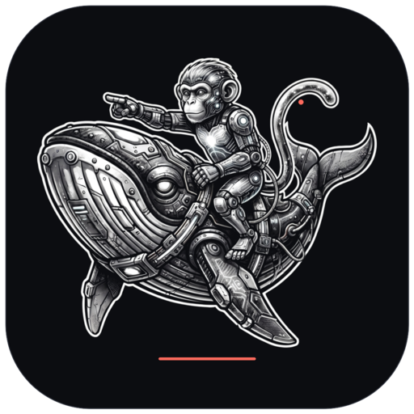

# ULTIMATE IAH

**Le cockpit agentique natif pour Omarchy, Arch Linux et le travail de code réel.**

Un seul poste de travail local pour l’agent, les notes, GitHub, la recherche web,
les skills, les bots, les providers et la création assistée.

<p>
  
  
  
  
  
</p>

**[Cockpit](#cockpit) · [Ultimate Agent](#ultimate-agent) · [4Crasy](#4crasy) · [Skills](#bibliothèque-de-skills) · [GitHub](#écosystème-github) · [Notes](#notes--graphe) · [Installation](#installation) · [Documentation](#documentation)**

</div>

---

## Mises à jour automatiques

À chaque ouverture, Ultimate IAH vérifie la dernière release GitHub. Si une
version plus récente existe, une bannière apparaît dans le Cockpit et dans
Réglages → Mises à jour.

- vérification réseau automatique et non bloquante ;
- comparaison sémantique des versions ;
- paquet officiel uniquement ;
- **SHA256 obligatoire** ;
- installation après confirmation par `pkexec` ;
- mise à jour versionnée des skills par défaut au démarrage ;
- aucun téléchargement ou redémarrage silencieux.

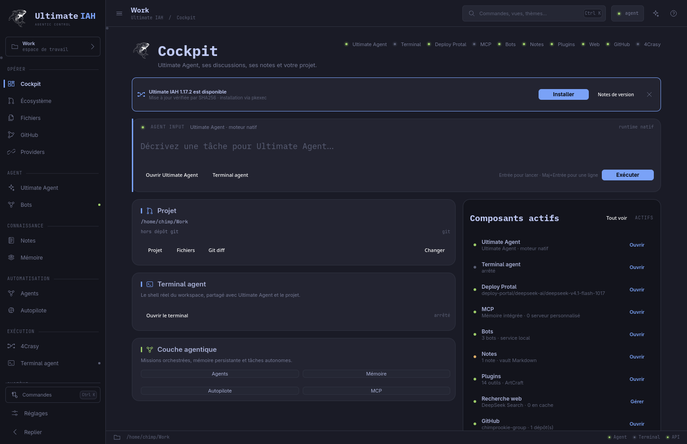

## Installation en une commande

```sh
curl -fsSL https://github.com/chimprookie-group/ULTIMATE-IAH/releases/latest/download/install.sh | bash
```

L’installateur vérifie les dépendances Arch, télécharge le paquet avec un
**checksum SHA256 obligatoire**, l’installe via `pkexec`, initialise les skills,
la configuration et le jeton 4Crasy, puis lance le diagnostic du harness.

Variante avec la suite ArtCraft :

```sh
curl -fsSL https://github.com/chimprookie-group/ULTIMATE-IAH/releases/latest/download/install.sh | bash -s -- --with-artcraft
```

## Pourquoi Ultimate IAH

Les outils d’IA sont souvent dispersés entre un chat, un terminal, un éditeur,
un navigateur et plusieurs services web. Ultimate IAH les réunit dans une
application Qt 6 native :

- un moteur agentique qui appelle de vrais outils et vérifie ses résultats ;
- des conversations persistantes et compactables ;
- un vault Markdown avec backlinks et graphe ;
- une bibliothèque de skills qui se sélectionne automatiquement ;
- un routeur de modèles gratuits, **4Crasy**, avec API OpenAI-compatible ;
- GitHub, les providers, MCP, les bots et ArtCraft au même endroit ;
- des données locales, des permissions explicites et aucun harness web embarqué.

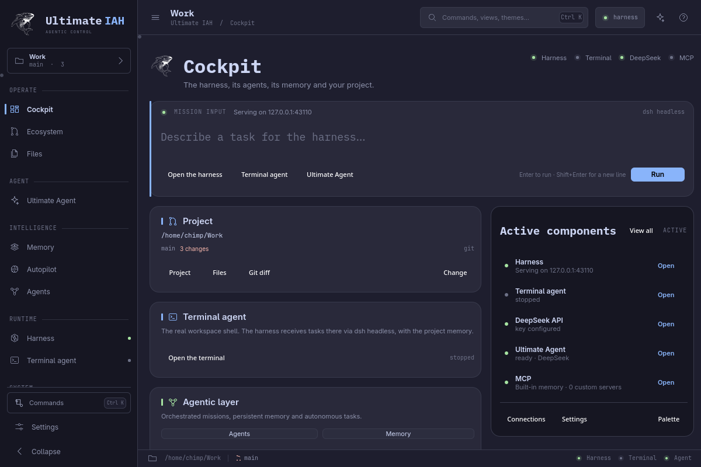

## Cockpit

Le Cockpit présente l’état réel de l’écosystème, le projet courant, le terminal,
le provider par défaut, les notes, GitHub, 4Crasy et les composants actifs.

- workspace et état Git ;
- accès direct à Ultimate Agent et au terminal ;
- jauge des composants actifs ;
- navigation vers les missions, la mémoire, les notes et les plugins ;
- raccourcis clavier cohérents dans toute l’application.

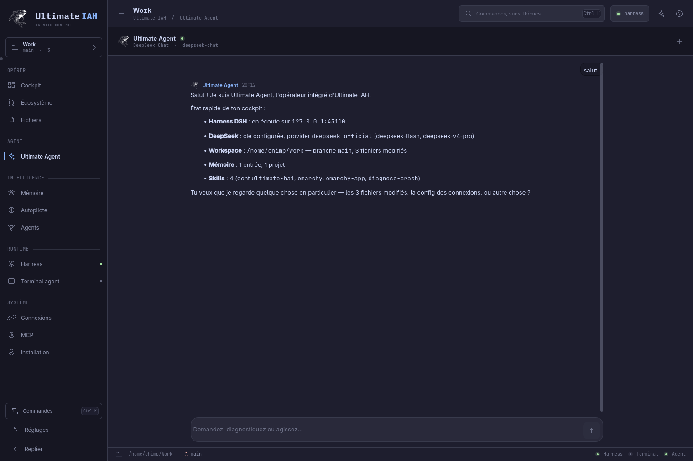

## Ultimate Agent

**Ctrl+Alt+U** ouvre Ultimate Agent.

### Capacités

- **Boucle agentique native** : appels d’outils, résultats réels, arrêt propre et
  limite de tours.
- **Conversations persistantes** : historique SQLite, recherche, renommage,
  épinglage, archivage, suppression et export Markdown.
- **Modes** : Assistant, Plan, Diagnostic, Construction et Revue.
- **Contexte** : jauge, compaction et pruning des résultats d’outils.
- **Images** : pièces jointes, aperçu, agrandissement et transmission aux
  modèles compatibles vision.
- **Permissions** : `read-only` ou `workspace-write`, vérifiées dans chaque
  outil.
- **Outils** : diagnostic, providers, MCP, mémoire, skills, notes, missions,
  terminal, fichiers, Git, GitHub, web, installation et réglages.
- **Job headless** : le même moteur est utilisé par les bots, les missions,
  l’autopilote et `--agent-job`.

### Utilisation en CLI

```sh
# version et diagnostic
ultimate-iah --version
ultimate-iah doctor --json

# job agent natif
ultimate-iah --agent-job \
  --agent-prompt "Corrige le test qui échoue et prouve-le" \
  --workspace ~/Work/mon-projet \
  --permission workspace-write

# skills
ultimate-iah skill install
```

## 4Crasy

**4Crasy** est le routeur natif de modèles gratuits. Il ne dépend pas d’un
service web externe et n’écoute que sur la loopback.

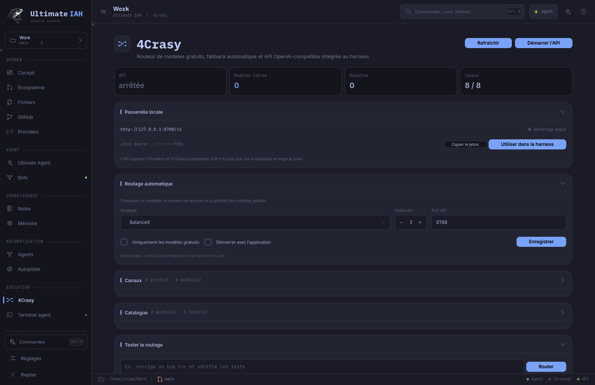

- API OpenAI-compatible : `http://127.0.0.1:8788/v1` ;
- `GET /health`, `GET /v1/models`, `POST /v1/chat/completions` ;
- jeton Bearer privé, stocké en `0600` ;
- découverte OpenRouter, Groq, Gemini, DeepSeek et Ollama ;
- modèles gratuits marqués `free` ;
- sélection automatique selon la tâche, la priorité, le contexte et la
  préférence gratuite ;
- fallback entre canaux ;
- bouton **Utiliser dans le harness** : crée le provider `4crasy` et le rend
  par défaut ;
- configuration par canal : nom, URL, clé API, priorité, gratuit/payant,
  activation, test de connexion, ajout et suppression ;
- port API, fallback maximal, stratégie Free/Balanced/Quality, mode gratuit
  strict et démarrage automatique configurables ;
- panneaux repliables pour garder l’interface lisible.

Modes headless :

```sh
ultimate-iah --router-service
ultimate-iah --router-configure
```

Voir [docs/4CRASY.md](docs/4CRASY.md).

## Bibliothèque de skills

Ultimate IAH installe **12 skills par défaut** dans `~/.agents/skills` :

| Skill | Usage |
|---|---|
| `research` | recherche web, sources et citations |
| `code-review` | revue de code, régressions et sécurité |
| `test-first` | boucle TDD et preuves |
| `debug` | reproduction et cause racine |
| `git-workflow` | branches, commits et PR |
| `github-project` | dépôts, issues et pull requests |
| `notes-vault` | notes, wikilinks et graphe |
| `security` | audit permissions, secrets et entrées |
| `release` | build, paquet et installation |
| `automation` | bots et planifications |
| `refactor` | simplification sûre |
| `artcraft` | suite créative |

- seeding idempotent, sans écraser un skill utilisateur ;
- sélection automatique des skills pertinents avant chaque requête ;
- skills projet dans `<workspace>/.agents/skills` ;
- lecture/écriture depuis `ultimate_skills` ;
- bouton **Bibliothèque par défaut** pour restaurer les fichiers manquants.

Voir [docs/SKILLS.md](docs/SKILLS.md).

## Écosystème GitHub

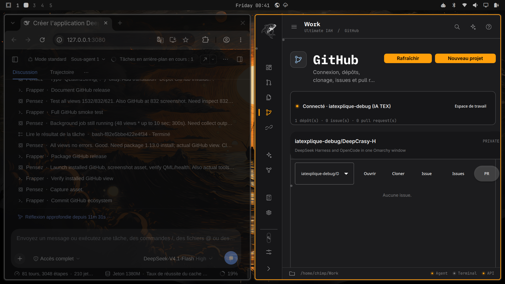

La vue **GitHub** (`Ctrl+Alt+H`) utilise le CLI `gh` et son keyring. Le token
n’est jamais lu, affiché ou journalisé par l’application.

- connexion au compte et état des scopes ;
- liste, filtre et détail des dépôts ;
- création d’un projet public ou privé ;
- clonage optionnel dans le workspace ;
- issues et pull requests ;
- création d’issue ;
- outils agent :

```text
github_status   github_repos    github_issues
github_pulls    github_clone    github_create_repo
github_create_issue
```

Les écritures GitHub nécessitent le mode `workspace-write`. Voir
[docs/GITHUB.md](docs/GITHUB.md).

## Notes + graphe

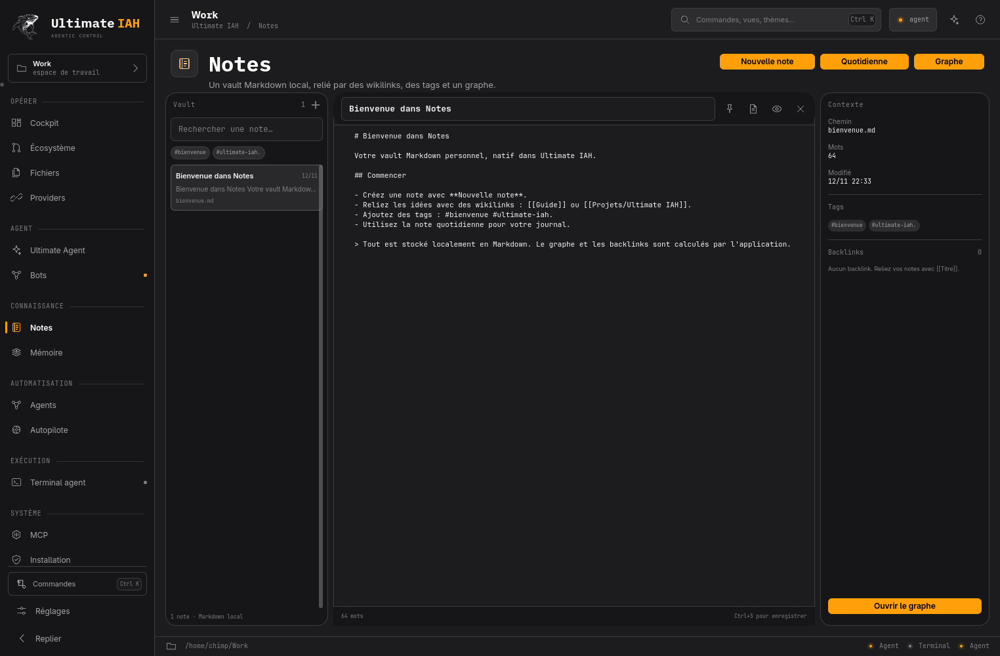

- vault Markdown local ;
- index SQLite, recherche, tags et épinglage ;
- **wikilinks `[[Titre]]`**, backlinks et graphe force-directed ;
- note quotidienne et autosauvegarde ;
- aperçu Markdown et images ;
- outil agent `ultimate_notes` ;
- accès depuis Notes, Plugins et Ultimate Agent.

Voir [docs/NOTES.md](docs/NOTES.md).

## Agents, missions et bots

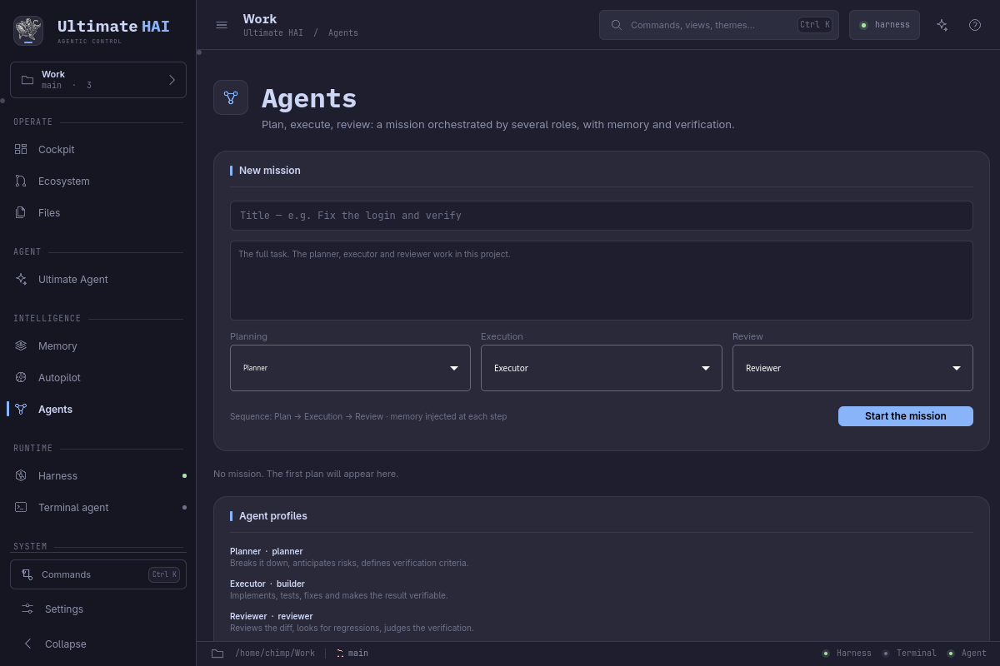

- profils Planner, Builder, Reviewer, Researcher et rôles personnalisés ;
- missions **Plan → Exécution → Revue** ;
- mémoire injectée à chaque étape ;
- permissions adaptées par rôle ;
- suivi SQLite, reprise et annulation.

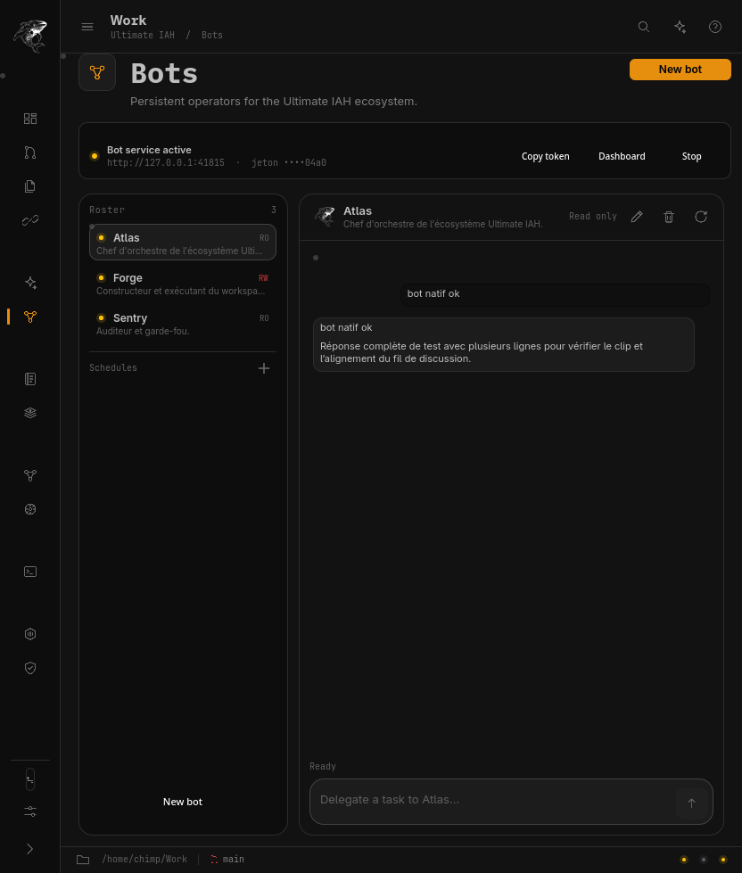

- bots persistants Atlas, Forge et Sentry ;
- création, édition, activation et suppression ;
- exécution par le job agent natif ;
- planifications ;
- API locale `127.0.0.1:8790` protégée par jeton ;
- dashboard web local et pont MCP `ultimate-iah-bots`.

## Recherche web et MCP

- `web_search` : DeepSeek Search, secours DuckDuckGo, sources et snippets ;
- `web_fetch` : HTTP(S), redirections same-origin, texte borné, cache ;
- blocage des adresses locales et privées ;
- résultats marqués comme contenu externe non fiable ;
- MCP stdio/HTTP et serveurs mémoire/bots intégrés ;
- outils exposés directement à Ultimate Agent.

## ArtCraft et plugins

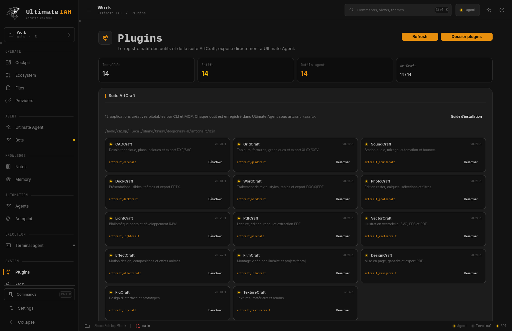

- **14 CLI ArtCraft** : CAD, Grid, Sound, Deck, Word, Photo, Light, Pdf, Vector,
  Effect, Film, Design, Fig et Texture ;
- outils dynamiques `artcraft_<craft>` ;
- détection réelle des binaires et versions ;
- activation persistante ;
- manifestes externes dans
  `~/.config/Crasy/deepcrasy-h/plugins/manifests` ;
- catalogue de **30 capacités DSH natives** et 12 extensions expérimentales
  visibles mais désactivées.

Voir [docs/PLUGINS.md](docs/PLUGINS.md).

## Design

L’interface utilise un langage commun de panneaux repliables et de boutons
secondaires contourés.

- sections à en-tête cliquable et chevron ;
- panneaux denses repliés par défaut ;
- boutons d’action remplis pour les actions principales ;
- boutons contourés pour les actions secondaires et « Configurer » ;
- états hover/focus stables, sans déplacement de géométrie ;
- mise en page vérifiée à 1532, 832 et 621 px.

## Architecture

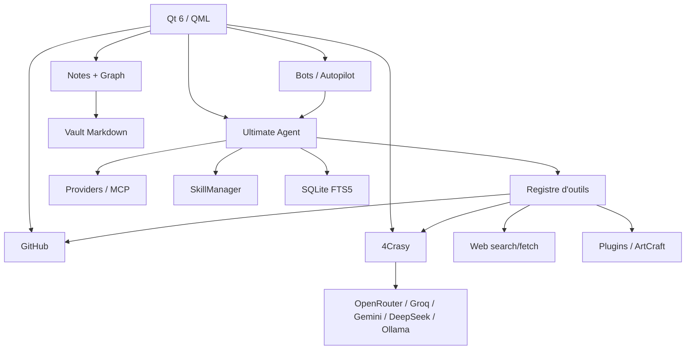

Couches principales :

- **Qt 6 / QML** : interface native et thème Omarchy ;
- **Ultimate Agent** : boucle, outils, permissions, conversations ;
- **Services** : `WebService`, `GitHubService`, `CrasyRouter`, `PluginManager`,
  `SkillManager`, `NoteStore`, `MemoryStore`, `MCP` ;
- **Persistance** : SQLite WAL, FTS5, Markdown et fichiers JSON ;
- **Jobs** : le binaire se réinvoque en mode headless, sans shell.

Voir [docs/ARCHITECTURE.md](docs/ARCHITECTURE.md).

## Installation

### Paquet Arch

```sh
pkexec pacman -U ultimate-iah-1.18.2-1-x86_64.pkg.tar.zst
```

Le paquet fournit :

- `/usr/bin/ultimate-iah` ;
- `ultimate-iah.desktop` ;
- icônes 128 → 1024 px ;
- remplacement de `ultimate-hai` et `deepcrasy-h` ;
- conservation des données existantes.

### Depuis les sources

```sh
git clone https://github.com/chimprookie-group/ULTIMATE-IAH.git
cd ULTIMATE-IAH
./bin/build
./bin/test
cd pkgbuild && makepkg -f
pkexec pacman -U ultimate-iah-1.18.2-1-x86_64.pkg.tar.zst
```

Prérequis principaux : Qt 6, QtWebEngine, Qt SVG, Qt Network, SQLite, Python 3,
PyYAML, Git, Node.js. `gh` est optionnel et active l’écosystème GitHub. Les
binaires ArtCraft sont détectés dans
`~/.local/share/Crasy/deepcrasy-h/artcraft/bin`.

## Raccourcis

| Touche | Action |
|---|---|
| `Ctrl+0` | Cockpit |
| `Ctrl+1` | Ultimate Agent |
| `Ctrl+2` | Terminal agent |
| `Ctrl+4` | Réglages |
| `Ctrl+6` | Écosystème |
| `Ctrl+7` | Fichiers |
| `Ctrl+8` | Providers |
| `Ctrl+Alt+U` | Ultimate Agent |
| `Ctrl+Alt+B` | Bots |
| `Ctrl+Alt+N` | Notes |
| `Ctrl+Alt+H` | GitHub |
| `Ctrl+Alt+4` | 4Crasy |
| `Ctrl+Alt+P` | Plugins et ArtCraft |
| `Ctrl+Alt+A` | Autopilote |
| `Ctrl+Alt+C` | MCP |
| `Ctrl+Alt+G` | Agents et missions |
| `Ctrl+Alt+M` | Mémoire |
| `Ctrl+K` | Palette de commandes |
| `?` | Aide |

## Données et sécurité

- Configuration : `~/.config/Crasy/deepcrasy-h/` ;
- données : `~/.local/share/Crasy/deepcrasy-h/` ;
- secrets : `agent.env`, `bot.token`, `4crasy/token` en `0600` ;
- GitHub : keyring `gh`, aucun token stocké par l’application ;
- 4Crasy : loopback uniquement, Bearer token, corps borné ;
- `web_fetch` : adresses privées bloquées ;
- plugins : processus sans shell, arguments explicites ;
- aucune télémétrie distante.

## Développement

```sh
./bin/build       # compilation qmake6
./bin/test        # suite Qt Test
./bin/install-user
```

La suite couvre notamment :

- stores SQLite et migrations ;
- conversations ;
- notes, wikilinks et graphe ;
- skills par défaut et sélection ;
- plugin manager et outils externes ;
- 4Crasy : démarrage loopback et parsing des modèles ;
- protection SSRF de `web_fetch` ;
- sécurité des politiques read-only.

État de référence : **42 tests passent** et **51 combinaisons vue × largeur**
ont été vérifiées sans erreur QML.

## Documentation

- [Architecture](docs/ARCHITECTURE.md)
- [Ultimate Agent](docs/AGENT.md)
- [4Crasy](docs/4CRASY.md)
- [GitHub](docs/GITHUB.md)
- [Skills](docs/SKILLS.md)
- [Notes](docs/NOTES.md)
- [Plugins](docs/PLUGINS.md)
- [Installation](docs/INSTALLATION.md)

## Limites connues

- 4Crasy expose actuellement des réponses non-streaming ; le harness utilise ce
  mode.
- L’autopilote est borné et nécessite que l’application reste ouverte.
- La mémoire est lexicale FTS5, sans embeddings ni synchronisation cloud.
- Les serveurs MCP s’exécutent avec les permissions de la session : n’activez
  que des commandes contrôlées.
- L’écosystème GitHub dépend de `gh` et de son authentification.

## Licence

MIT — voir [LICENSE](LICENSE).
