# DeepCrasy H

**Le cockpit Omarchy de DeepSeek Harness et OpenCode.**

[](LICENSE)


DeepCrasy H réunit les deux agents qui comptent sur le poste : le **DeepSeek
Harness** (son interface web complète, ses skills, ses sessions) et
**OpenCode** (son agent, ses modèles, ses appels d'outils), dans une
application Qt Quick native, installable comme n'importe quel paquet Omarchy.
Un seul espace de travail, deux moteurs, un cockpit, aucun terminal à ouvrir.


## Le cockpit

La vue **Accueil** (`Ctrl+0`) rassemble l'état réel du poste :

- le **dossier de travail**, sa branche Git et le nombre de modifications ;
- l'état du **harness** (profil, adresse, santé, test de connexion) ;
- l'état d'**OpenCode** (session, modèle, mode, jetons consommés) ;
- un **diagnostic** des binaires, du portail, de QtWebEngine, de Git et des
  notifications ;
- les **sessions récentes** pour reprendre un travail en un clic ;
- des actions directes : nouvelle session, ouvrir le harness, vue partagée,
  changer de dossier, lancer le diagnostic.

Les cartes se replient en une colonne dans une fenêtre étroite et suivent le
thème actif.

## L'écosystème

`Ctrl+6` ouvre le panneau **Écosystème** : il inspecte le projet et son
environnement, pas seulement les deux moteurs.

- **Projet** : type détecté (Qt/QML, Node, Python, Rust, Go, CMake, Make),
  gestionnaire de paquets, fichiers, et commandes prêtes à lancer dans le
  terminal intégré — tests, build, lint, Git, Docker.
- **Outils** : 15 binaires du poste, présents ou non, avec leur version.
- **Skills** : les skills Omarchy/agents installées, avec leur description et
  un bouton pour les confier à OpenCode avec leur chemin.
- **Modèles** : le catalogue complet `opencode models` (12 modèles libres
  ici), le provider connecté, et un accès direct à la connexion provider.
- **MCP et sessions** : serveurs configurés, reprise d'une session récente.
- **Recettes** : Expliquer, Relire, Tester, Corriger, Sécurité, Performance.
- **Contexte** : injecte un brief du projet (stack, commandes, Git, modèle,
  MCP, outils, skills) directement dans le composer.

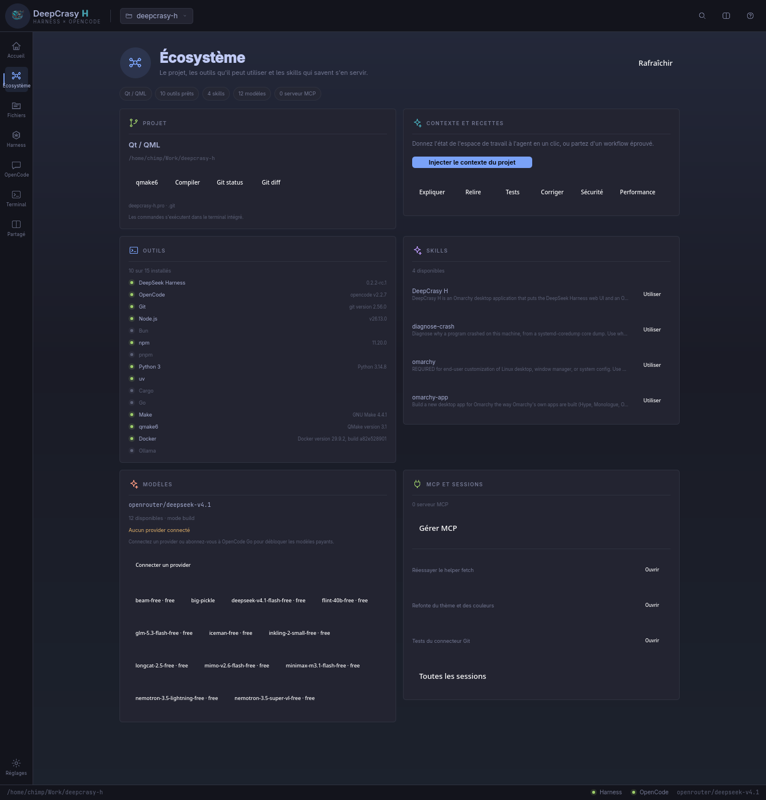

## 9Router : le routeur local dans l'écosystème

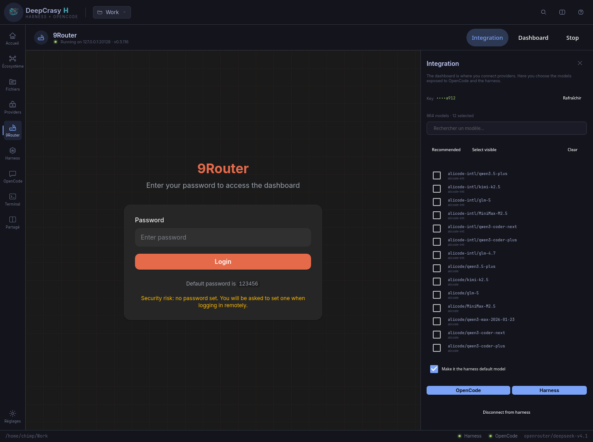

`Ctrl+9` ouvre **9Router** comme un service local géré par DeepCrasy H. Son
dashboard complet est embarqué : connexion des 40+ providers, comptes, quotas,
fallback et modèles. L'app démarre/arrête le service, détecte le port 20128,
crée ou réutilise une clé locale et affiche les **864 modèles** du catalogue.

Le panneau **Intégration** permet de choisir les modèles à exposer :

- **OpenCode** : 9Router écrit son provider OpenAI-compatible dans
  `opencode.json`, puis DeepCrasy H redémarre OpenCode.
- **Harness** : un patch `llm-pi-ai` est généré pour le profil DSH courant,
  avec `NINE_ROUTER_API_KEY` dans l'environnement du processus harness. Le
  modèle choisi peut devenir le modèle par défaut du harness.

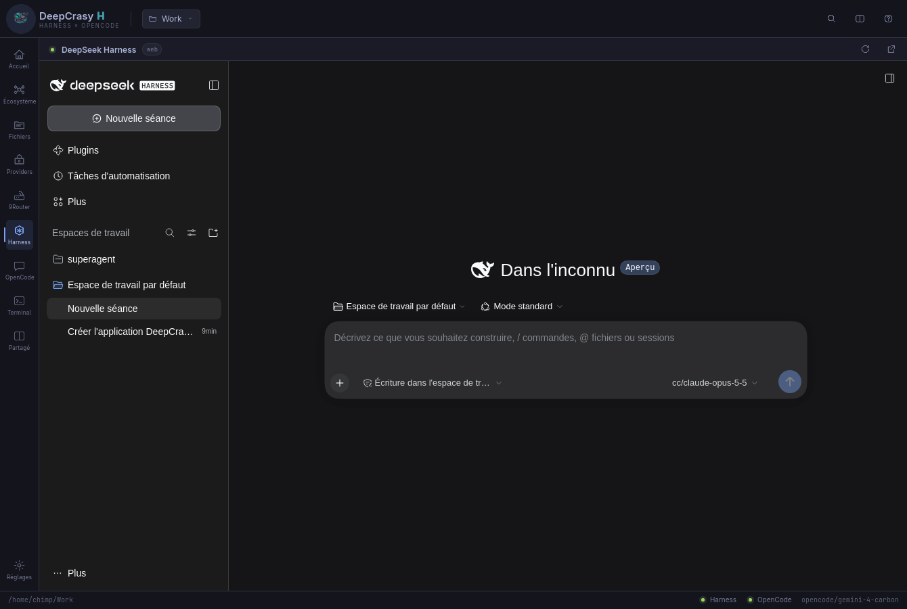

9Router est installé localement dans les données de l'application
(`npm install --prefix …`), sans root ni npm global. Le dashboard utilise le
mot de passe initial `123456` ; changez-le dans ses réglages. Le service écoute
uniquement sur `127.0.0.1`.

Si Node, npm ou PyYAML manquent, le bouton **Dépendances système (sudo)**
lance `pkexec pacman -S --needed --noconfirm nodejs npm python-yaml`. La
fenêtre polkit demande le mot de passe administrateur ; l'application ne le
voit jamais et l'installation locale de 9Router reste sans root.

## Providers : n'importe quelle API

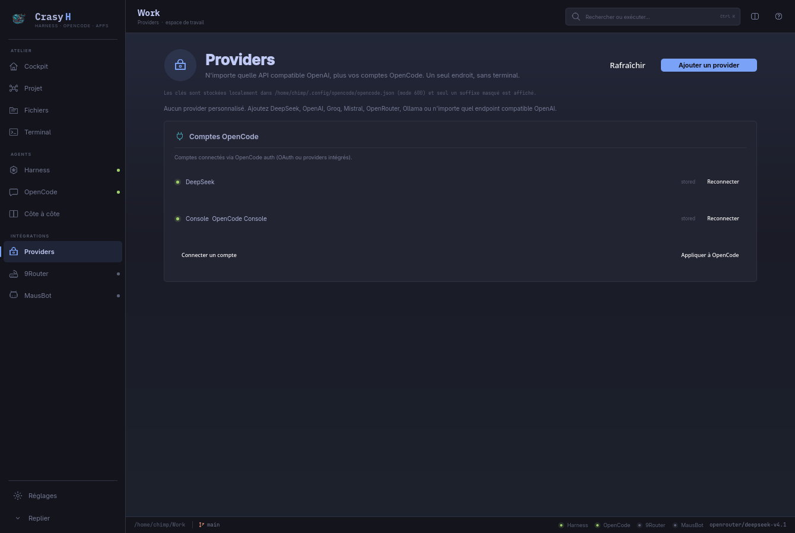

`Ctrl+8` ouvre le gestionnaire **Providers**. Il permet d'ajouter un provider
intégré ou n'importe quelle API **compatible OpenAI** : DeepSeek, OpenAI,
Groq, Mistral, OpenRouter, Ollama, un gateway maison. Chaque provider a son
ID, son URL de base, sa clé API, ses modèles et un bouton **Tester** qui
interroge réellement `/models`.

Les clés sont écrites dans `~/.config/opencode/opencode.json` avec le mode
`600` ; l'interface ne reçoit qu'un suffixe masqué (`••••1234`). Après
enregistrement, DeepCrasy H redémarre le service et OpenCode. Les modèles du
provider apparaissent dans le sélecteur et se choisissent directement.

La carte **Comptes OpenCode** garde les connexions OAuth et providers intégrés
(`opencode auth`) : reconnexion, ajout d'un compte, application.

## Contexte et pièces jointes

Depuis **Fichiers**, un fichier s'ajoute au prochain message avec **Joindre au
chat**. Le composer affiche une puce par fichier (5 maximum) ; à l'envoi, le
contenu est intégré dans des blocs `<file path="…">` avec le prompt. Une puce
se retire d'un clic.

Le composer garde aussi un **historique de prompts** (`↑` / `↓` quand le champ
est sur une ligne) et le bouton d'envoi devient **Stop** pendant une génération.
Le panneau **Sessions** a une recherche par titre ou identifiant.

## Fichiers et diff

`Ctrl+7` ouvre l'explorateur du workspace : liste des fichiers suivis par Git
(ou parcours borné sans Git), filtre, statut, aperçu texte en lecture seule et
**diff Git** du fichier sélectionné. Un fichier se confie à OpenCode pour
l'expliquer, ou s'ouvre dans l'éditeur du bureau. Aucun fichier n'est modifié
depuis cette vue.

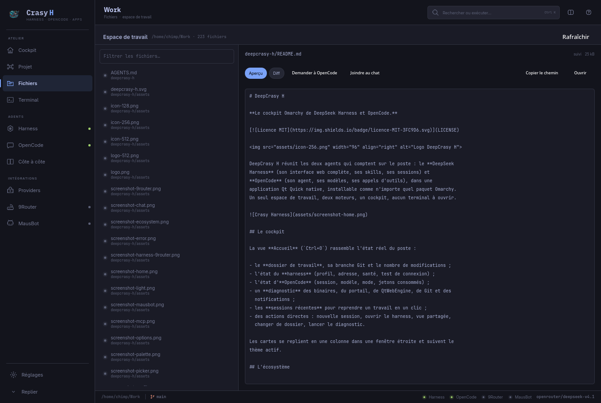

## Palette de commandes

`Ctrl+K` (ou la loupe de l'en-tête) ouvre une palette qui interroge tout :
vues, actions, thèmes installés, langues, sessions récentes. La recherche
ignore les accents — « reglages » trouve « Réglages » — et tout se pilote au
clavier (`↑↓`, `Entrée`, `Échap`).

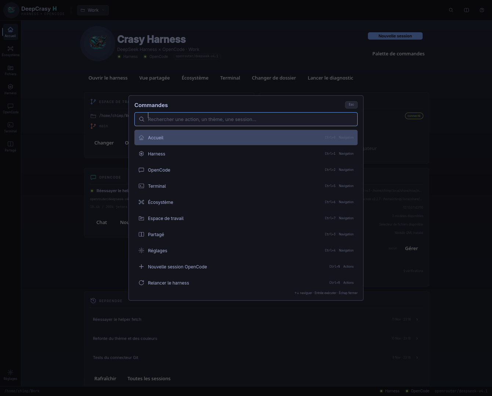

## Thèmes

DeepCrasy H lit les `colors.toml` d'Omarchy et suit le thème du bureau par
défaut. **Réglages → Apparence** liste tous les thèmes installés avec un aperçu
réel de leur palette ; le choix s'applique instantanément, reste propre à
l'application et ne touche pas à la configuration du bureau.

Tout est dérivé de la palette : fonds, bordures, texte secondaire, icônes
teintées, accents, couleurs de statut. Les thèmes clairs restent lisibles, les
sombres gardent leur caractère.

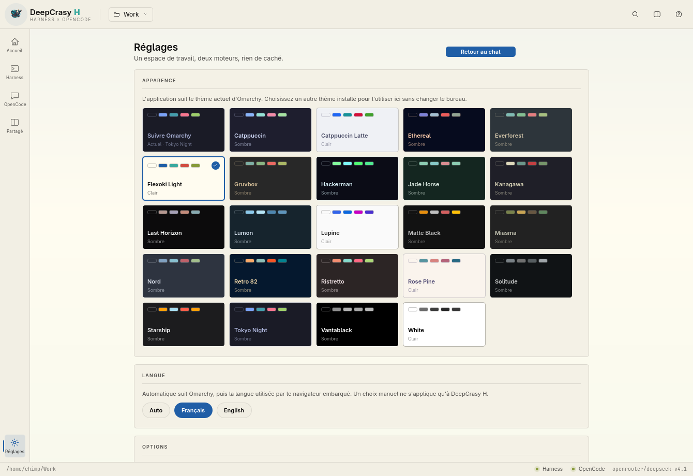

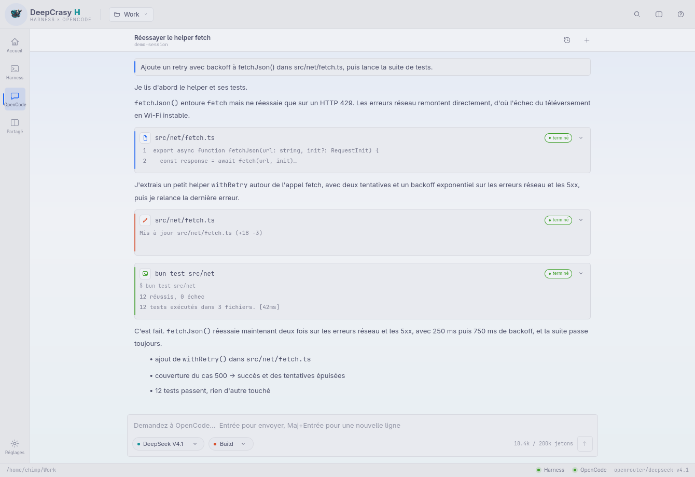

## Langues

L'interface existe en **français** et en **anglais**. En mode automatique, elle
suit la langue d'Omarchy, puis celle du navigateur embarqué (celle que le
harness utilise déjà), puis la locale du système. **Réglages → Langue** permet
de forcer Français, English ou Auto — pour DeepCrasy H uniquement.

Le chat, les appels d'outils, les permissions, les erreurs, le cockpit et la
palette passent tous par le même catalogue.

## Options et connexions

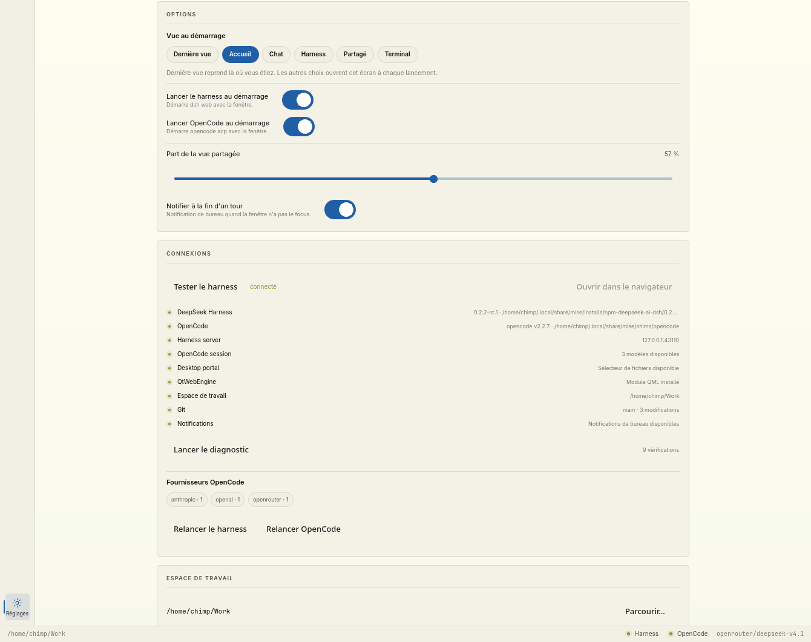

- **Vue au démarrage** : dernière vue, accueil, chat, harness ou vue partagée.
- **Lancement automatique** du harness et d'OpenCode, indépendamment.
- **Part de la vue partagée**, réglable au pourcentage.
- **Notification de bureau** à la fin d'un tour quand la fenêtre est inactive.
- **Diagnostic complet** : `dsh`, `opencode`, serveur harness, session
  OpenCode, portail XDG, QtWebEngine, espace de travail, Git, notifications.
- **Test de connexion** au harness (requête HTTP réelle, sans afficher le
  token).
- **Fournisseurs OpenCode** détectés depuis les modèles disponibles, et
  redémarrage des deux moteurs.

## Erreurs actionnables

Quand OpenCode renvoie une limite d'usage, un provider manquant ou une erreur de
session, le message ne reste plus une réponse morte : il devient une carte avec
**Changer de modèle**, **Gérer les providers** et **Réessayer**. Le bouton
ouvre le gestionnaire de providers, où la clé peut être remplacée par un
provider personnalisé ou un compte OpenCode reconnecté. Le dernier prompt est
conservé pour le retry.

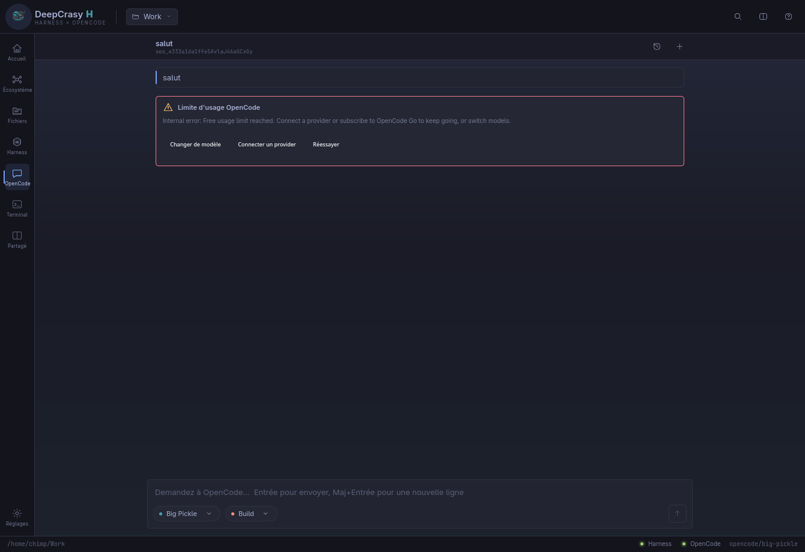

## Profils de travail

Un **profil** mémorise le modèle OpenCode et le mode courants. Enregistrez-en un
depuis **Réglages → Profils de travail**, puis retrouvez-le dans le composer à
côté du modèle et du mode. Le profil actif est réappliqué au prochain démarrage
d'OpenCode. Idéal pour passer de « Revue » (Plan) à « Implémentation » (Build)
sans tout resélectionner.

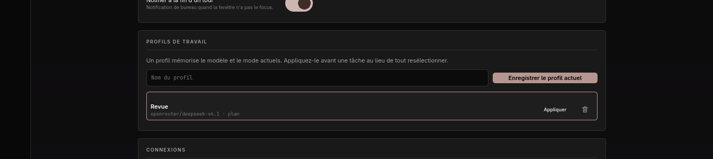

## Terminal

`Ctrl+5` ouvre un vrai terminal dans le dossier de travail. C'est un **PTY**
(`forkpty`), pas un faux champ de commande : le shell de l'utilisateur, sa
complétion, ses couleurs et ses programmes plein écran. Il reste vivant quand
on change de vue, suit le thème actif, se redimensionne avec la fenêtre, et
`Ctrl+Shift+C` / `Ctrl+Shift+V` copient et collent. Le rendu est xterm.js (MIT).

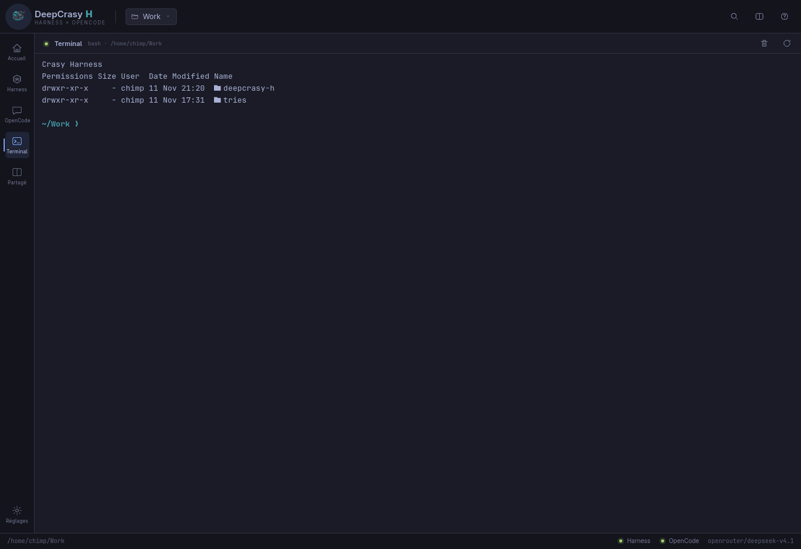

## Serveurs MCP

**Réglages → Serveurs MCP** gère les serveurs d'outils exposés à OpenCode :
liste fusionnée avec type, cible et portée, ajout d'un serveur local (`npx …`)
ou distant (`https://…`), retrait, et statut demandé à `opencode mcp list`.
Deux portées sont disponibles : **Global** dans
`~/.config/opencode/opencode.json`, et **Projet** dans
`<espace de travail>/opencode.json`. Le fichier choisi est modifié de façon
atomique, sans toucher au thème, à l'autoupdate ni au reste de la
configuration. Un bouton relance OpenCode pour charger un serveur qui vient
d'être ajouté ; le statut reste best-effort et peut afficher « Non testé » tant
que le service n'a pas rechargé.

Chaque serveur distant porte un badge **OAuth** coloré selon son état
(connecté, en attente, échec, non testé). Les serveurs **distants** ont un
bouton clé : DeepCrasy H lance
`opencode mcp auth <nom> --standalone`, reconnaît l'URL d'autorisation,
l'ouvre dans le navigateur et attend la fin du flux. L'URL reste cliquable
dans le bandeau, l'authentification peut être annulée, et le statut est
rafraîchi au retour. Un second bouton lance
`opencode mcp logout <nom>` et efface les identifiants OAuth stockés ; le
résultat s'affiche dans le même bandeau. Le CLI sortant 0 même en cas
d'échec, le résultat est aussi lu dans sa sortie.

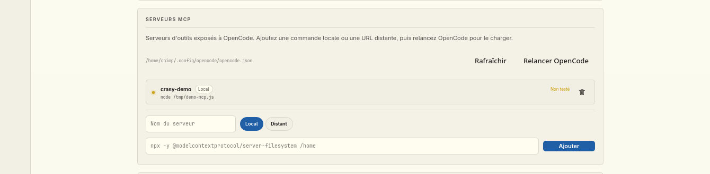

## En bref

- **Un seul espace de travail.** Le dossier choisi est partagé : le harness y
  démarre son serveur, OpenCode y ouvre sa session.
- **Le harness est embarqué.** `dsh web` est lancé sur un port libre ; l'URL
  tokenisée qu'il imprime est chargée dans le moteur Chromium de Qt.
- **OpenCode est natif.** `opencode acp` est piloté via l'**Agent Client
  Protocol** : sessions, modèles, modes, appels d'outils, permissions et
  streaming sont rendus par l'application.
- **Vue partagée** harness + chat (à partir de 1180 px de large), avec bascule
  instantanée et transcript conservé.
- **Terminal intégré** (`Ctrl+5`) : PTY réel, shell de l'utilisateur, thème,
  copier/coller, redémarrage.
- **Serveurs MCP** : liste fusionnée global/projet, ajout local ou distant,
  retrait, authentification et déconnexion OAuth des serveurs distants, statut
  et redémarrage d'OpenCode depuis Réglages.
- **Écosystème** : détection du projet, commandes dans le terminal, outils,
  skills, modèles, recettes et brief de contexte.
- **Fichiers et diff** : exploration du workspace, aperçu et diff Git, envoi
  d'un fichier à OpenCode.
- **Profils de travail** : modèle + mode mémorisés, appliqués au redémarrage.
- **Erreurs actionnables** : limite d'usage, provider manquant, retry et
  connexion provider depuis la carte d'erreur.
- **9Router intégré** : service local, dashboard embarqué, 864 modèles,
  connexion OpenCode et harness, choix des modèles exposés.
- **Gestionnaire de providers** : n'importe quelle API compatible OpenAI,
  clé masquée, test `/models`, modèles, comptes OpenCode.
- **Catalogue de modèles complet**, pièces jointes, historique de prompts et
  recherche de sessions.
- **Thèmes complets, français et anglais, palette de commandes, diagnostic,
  Git, notifications.**
- **Une seule fenêtre Wayland**, un binaire, une entrée de lanceur, une icône.

## Installer

### Paquet Arch / Omarchy

```sh
cd ~/Work/deepcrasy-h
./bin/install          # construit puis makepkg -fsi (demande sudo)
```

Le paquet installe `/usr/bin/deepcrasy-h`, l'entrée `.desktop`, l'icône
scalable et les PNG 256/512. L'application apparaît ensuite dans le lanceur
Omarchy (`Super + Espace`).

### Sans root

```sh
./bin/install-user     # ~/.local/bin + ~/.local/share/{applications,icons}
```

### Depuis les sources

```sh
./bin/build            # qmake6 + make → build/deepcrasy-h
./build/deepcrasy-h    # lance l'application
```

### Prérequis

| Outil | Rôle | Vérification |
| --- | --- | --- |
| `dsh` | DeepSeek Harness, lancé en `dsh web` | `dsh --version` |
| `opencode` | OpenCode, lancé en `opencode acp` | `opencode --version` |
| `git` | branche et modifications du cockpit, optionnel | `git --version` |
| Qt 6 | `qt6-base`, `qt6-declarative`, `qt6-webengine`, `qt6-svg`, `qt6-wayland` | fourni par Omarchy |

```sh
deepcrasy-h doctor          # tableau lisible
deepcrasy-h doctor --json   # pour un agent ou un script, code 0 si tout est prêt
```

Les chemins vers `dsh` et `opencode`, ainsi que le profil du harness, se
règlent dans **Réglages** (`Ctrl+4`).

## Utilisation

| Raccourci | Action |
| --- | --- |
| `Ctrl+0` | Cockpit Crasy Harness |
| `Ctrl+1` | DeepSeek Harness |
| `Ctrl+2` | Chat OpenCode |
| `Ctrl+3` | Vue partagée (les deux panneaux) |
| `Ctrl+4` | Réglages |
| `Ctrl+5` | Terminal intégré |
| `Ctrl+6` | Écosystème du projet |
| `Ctrl+7` | Fichiers et diff du workspace |
| `Ctrl+K` | Palette de commandes |
| `Ctrl+L` | Aller à la saisie |
| `Entrée` | Envoyer le message |
| `Maj+Entrée` | Nouvelle ligne |
| `Ctrl+N` | Nouvelle session OpenCode |
| `Ctrl+M` | Choisir le modèle |
| `Ctrl+R` | Relancer le harness |
| `?` / `F1` | Toutes les touches |
| `Échap` | Fermer la fenêtre active |
| `Q` | Quitter (confirmation si un tour est en cours) |

Le bouton de dossier dans l'en-tête change d'espace de travail via le portail
XDG. Le harness redémarre dans le nouveau dossier et OpenCode y ouvre une
session ; le transcript en cours est abandonné, l'ancienne session reste
consultable dans l'historique.

La vue partagée demande au moins 1180 px de large. En dessous, l'application
revient au chat et affiche un message : une fenêtre carrelée sur une moitié
d'écran reste ainsi lisible.

Le chat et le sélecteur de modèle :

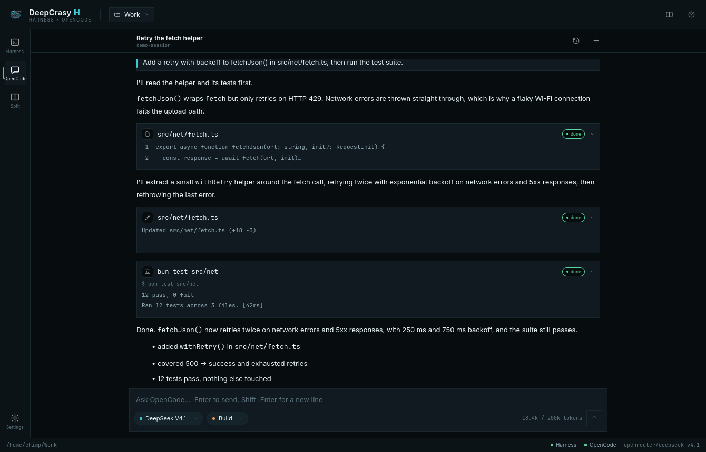

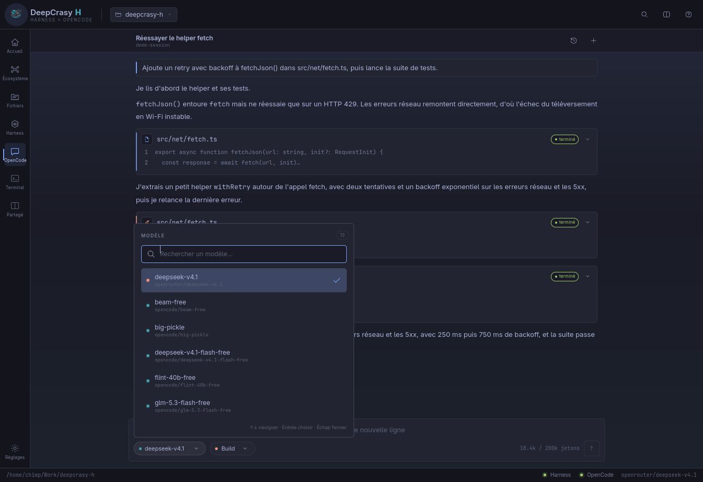

## Comment ça marche

```text
┌──────────────────────── DeepCrasy H (Qt Quick) ─────────────────────────┐
│  Cockpit · Palette · Thèmes · Réglages                                  │
│  DeepSeek Harness                    │  OpenCode                         │
│  QtWebEngine ← http://127.0.0.1:PORT │  chat natif ← JSON-RPC/stdio       │
│   (?token=…)                         │                                   │
└──────────────┬───────────────────────┴──────────────┬────────────────────┘
               │ QProcess                             │ QProcess
        ┌──────▼──────┐                        ┌──────▼──────┐
        │  dsh web    │                        │ opencode acp│
        └─────────────┘                        └─────────────┘
                     même dossier de travail
```

- `src/harnessserver.*` lance `dsh web --no-open --port 0`, lit la ligne
  `dsh web: http://…/?token=…` et la transmet à la vue.
- `src/acpclient.*` parle JSON-RPC 2.0 sur stdio : `initialize`,
  `session/new`, `session/load`, `session/list`, `session/prompt`,
  `session/cancel`, `session/set_config_option`, `session/update` et
  `session/request_permission`.
- `src/backend.*` est la façade QML : un espace de travail, deux moteurs, un
  seul état. Il porte aussi le diagnostic, Git, le test de connexion et les
  notifications.
- `src/terminalsession.*` ouvre un PTY avec `forkpty`, décode l'UTF-8 au fil de
  l'eau et expose l'entrée/sortie à xterm.js via QWebChannel. `src/terminal/`
  contient xterm.js et son addon de redimensionnement.
- `src/mcpmanager.*` lit et écrit la section `mcp.servers` des configurations
  OpenCode globale et de projet, et interroge `opencode mcp list` en
  arrière-plan pour les statuts.
- `src/ecosystem.*` détecte le type de projet, les commandes, les outils et les
  skills, et compose le brief de contexte. `TerminalSession::run()` met une
  commande en attente puis l'exécute quand le shell est prêt.
- `src/workspacemodel.*` liste les fichiers Git ou parcourt le dossier, filtre,
  lit un aperçu sûr et produit le diff d'un fichier.
- Les profils vivent dans `Config` (nom, modèle, mode, profil actif) et sont
  réappliqués par `Backend` quand OpenCode publie ses options.
- `AcpClient::classifyFailure()` transforme les réponses de limite d'usage ou
  de provider manquant en messages `error` ; le dernier prompt est conservé
  pour `retryLastPrompt()`. La carte d'erreur ouvre le modèle, le terminal
  d'authentification ou relance le prompt.
- `Ecosystem::refreshModels()` charge `opencode models` et `opencode auth list`
  pour le catalogue et le provider. Le composer assemble les pièces jointes en
  blocs `<file>` et garde 50 prompts d'historique.
- `NineRouterManager` lance le service local, s'authentifie, récupère la clé et
  les modèles, puis appelle l'endpoint OpenCode natif de 9Router. Pour le
  harness, il génère un patch `llm-pi-ai` et un fichier d'environnement ;
  `HarnessServer` passe `--patch` et `NINE_ROUTER_API_KEY` à `dsh`.
- `ProviderManager` écrit les entrées `providers` d'OpenCode
  (`package: @opencode/ai/providers/openai-compatible`, `settings.baseURL`,
  `settings.apiKey`, `models`) et teste `/models` en HTTP. Les clés sont en
  mode 600 et ne traversent jamais QML en clair.
- `src/messagemodel.*` expose le transcript comme un vrai modèle de liste :
  un token streame ne réécrit qu'une ligne, la ListView garde ses délégués et
  sa position. L'auto-scroll est coalescé à 40 ms et le bas du transcript garde
  une marge au-dessus du composer.
- `src/gitstatus.*` lit `git status --porcelain=v1 -b` sans toucher au dépôt ;
  `src/theme.*` lit les palettes Omarchy et en dérive toute l'interface ;
  `src/iconprovider.*` teinte les SVG avec la bonne couleur.
- `src/config.*` persiste tout dans
  `~/.config/Crasy/deepcrasy-h/config.json` (écriture atomique).
- Le cookie du harness persiste dans
  `~/.local/share/Crasy/deepcrasy-h/QtWebEngine/deepcrasy-h`, mais l'URL
  tokenisée est rechargée à chaque démarrage.
- Aucun réseau sortant n'est ajouté par DeepCrasy H. Le harness écoute sur
  l'interface locale ; OpenCode reste un processus enfant.

`docs/ARCHITECTURE.md` détaille les décisions et les limites.

## Configuration

| Chemin | Contenu |
| --- | --- |
| `~/.config/Crasy/deepcrasy-h/config.json` | espace de travail, profil, binaires, vue, thème, langue, options |
| `~/.local/share/Crasy/deepcrasy-h/QtWebEngine/` | cookies et stockage local du harness |
| `~/.cache/Crasy/deepcrasy-h/` | cache WebEngine |

Le profil `web` est utilisé par défaut : un profil personnel peut contenir des
plugins à instance unique (l'agent du bureau, par exemple) qui refusent un
second lancement. Indiquez votre profil dans **Réglages** si vous savez qu'il
peut cohabiter.

## Développement

```sh
./bin/build     # compile
./bin/test      # tests Qt, dont un vrai aller-retour ACP avec OpenCode
./bin/install   # paquet système
```

Les tests couvrent l'extraction de l'URL tokenisée, la persistance et la
validation de la configuration (options comprises), l'édition sûre de la
configuration MCP, la lecture Git, le thème, les catalogues de langue, un
**vrai** PTY (commande envoyée au shell et sortie relue), et un **vrai**
`opencode acp` : démarrage, session, prompt, réponse streamée. Pour sauter ce dernier (pas de réseau) :

```sh
DEEPCRASY_SKIP_INTEGRATION=1 ./bin/test
```

Structure :

```text
deepcrasy-h.pro         projet qmake
bin/build               qmake6 + make
bin/test                Qt Test hors écran
bin/install             makepkg -fsi
bin/install-user        installation dans ~/.local
src/                    C++ et QML, à plat
tests/                  Qt Test
pkgbuild/               PKGBUILD, .desktop, icône
assets/                 logo et captures
```

Pour une capture reproductible sans données personnelles :

```sh
QT_QPA_PLATFORM=offscreen ./build/deepcrasy-h \
  --demo --screenshot /tmp/deepcrasy.png

# Une autre taille, un thème précis, la palette ouverte
QT_QPA_PLATFORM=offscreen ./build/deepcrasy-h \
  --theme catppuccin-latte --view home --height 1000 --palette \
  --screenshot /tmp/cockpit.png
```

## Stabilité

DeepCrasy H n'accepte qu'une instance par utilisateur : relancer l'application
ramène la fenêtre existante au premier plan au lieu de créer un second profil
QtWebEngine et un conflit de portail. Le catalogue de modèles est chargé à
l'ouverture du sélecteur, pas avant l'affichage de la fenêtre.

Qt 6.12 peut livrer un nœud de glyphe sans matrice au batch renderer ;
`Element::computeBounds()` déréférence alors `node->matrix()` et crashe dans
`prepareAlphaBatches()`. Avant chaque rendu, DeepCrasy H parcourt le scene graph
et donne une matrice identité aux nœuds de géométrie qui n'en ont pas. La boucle
Quick `basic` (même thread que l'interface) rend ce garde-fou sûr. C'est un
contournement d'un bug Qt, à retirer quand Qt Quick sera corrigé.

## Limites connues

- La vue partagée n'a pas de séparateur déplaçable à la souris ; la part est
  réglée dans **Options** (57 % par défaut).
- Le rendu Markdown s'appuie sur `Text.MarkdownText`. Les blocs de code sont
  lisibles, mais sans coloration syntaxique.
- Le harness peut afficher sa propre fenêtre d'accueil à la première
  utilisation ; c'est son interface, pas celle de DeepCrasy H.
- ACP est jeune : les mises à jour de session inconnues sont ignorées plutôt
  que devinées.
- Le thème choisi ne s'applique qu'à DeepCrasy H. L'interface web du harness
  garde son propre thème, et `omarchy theme set` continue de piloter le bureau.

## Licence

MIT — voir [LICENSE](LICENSE). Le logo appartient à Crasy. Le terminal embarque
xterm.js (MIT) — voir [THIRD_PARTY.md](THIRD_PARTY.md).

Dépôt : <https://github.com/iatexplique-debug/DeepCrasy-H>
