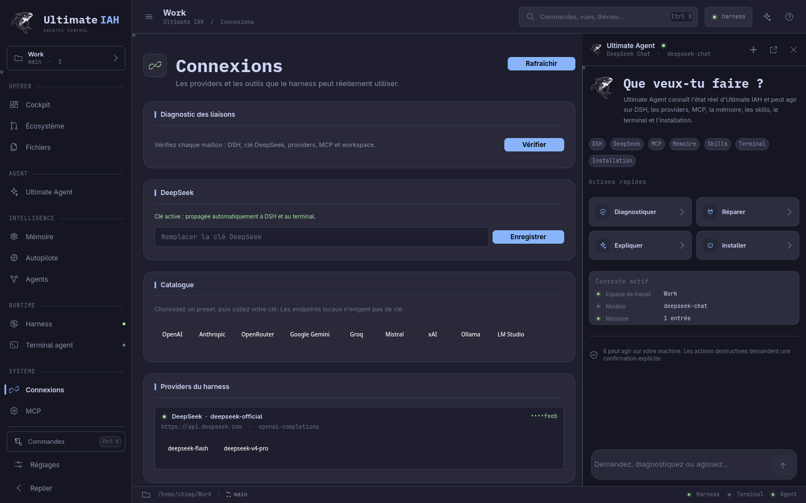
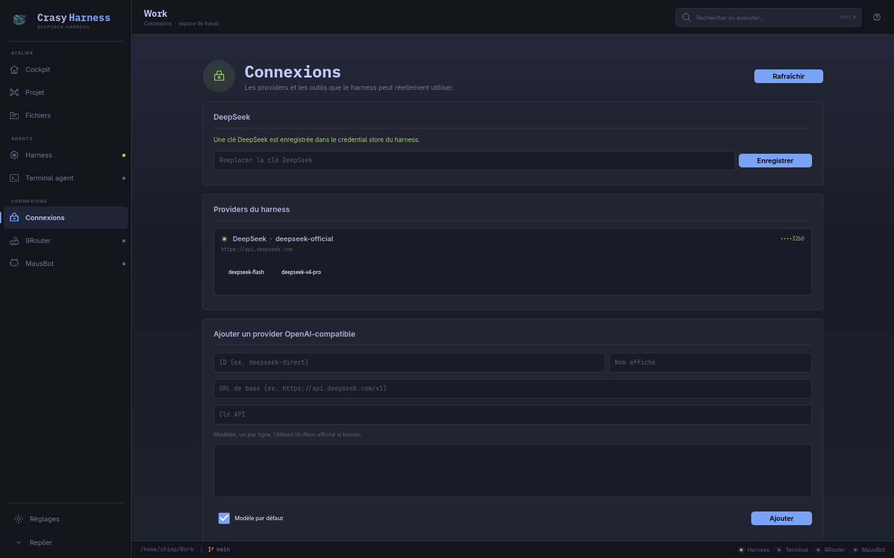
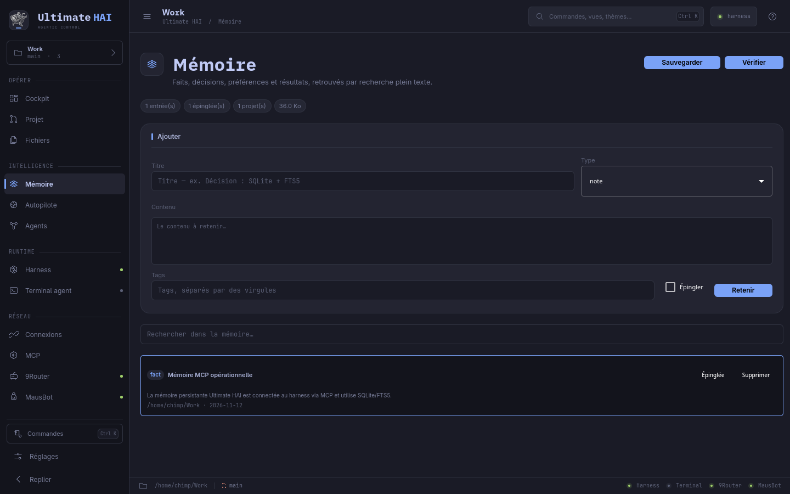
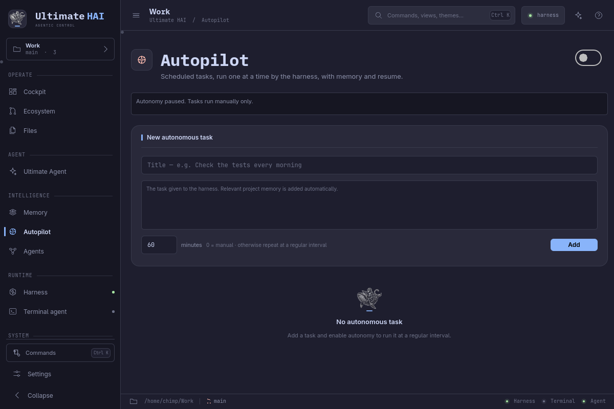

# Ultimate IAH

**Le cockpit agentique du DeepSeek Harness pour Omarchy.**

Ultimate IAH réunit le harness, des agents orchestrés, une mémoire persistante,
un terminal réel, un autopilote borné et un centre de connexions providers/MCP
— sans OpenCode.


## Identité

La baleine musclée est le nouveau logo d'Ultimate IAH. Le fond clair a été
détouré avec précision : variante blanche sur les thèmes sombres, variante encre
sur les thèmes clairs. Dans le rail, le logo est posé directement, sans tuile
autour, pour lui laisser de l'air. Il structure aussi les en-têtes de page, les
états vides d'Ultimate Agent et de la mémoire, l'écran Harness, la palette,
l'aide et le À propos. L'icône du lanceur utilise une tuile encre arrondie avec
la baleine blanche et un discret trait d'accent.

## Agentique


- **Profils d'agents** : planificateur, exécutant, réviseur, chercheur, et rôles
  personnalisés.
- **Missions Plan → Exécution → Revue** : trois appels `dsh headless` successifs,
  avec mémoire et résultats intermédiaires transmis.
- **Skills gérés** : bibliothèque utilisateur et projet, création et suppression
  depuis l'interface, réutilisation dans une mission.
- **Permissions adaptées** : planificateur et réviseur en lecture seule ;
  exécutant en `workspace-write` ; approbation `never` pour le mode headless.
- **Suivi persistant** : chaque mission et chaque étape est stockée dans SQLite,
  avec reprise, annulation et sorties consultables.

## Installation complète

La vue **Installation** (`Ctrl+Alt+I`) audite et installe l'écosystème complet :
runtime DSH, Node, npm, Python, PyYAML, QtWebEngine, Git, portail fichiers,
MCP mémoire et entrées de bureau. Le runtime DSH système
(`/usr/lib/crasy/dsh`) est utilisé en priorité ; sinon DSH peut être installé
localement sans droits administrateur.

## Ultimate Agent

La politique **one-shot** est embarquée dans le paquet et dans la mémoire
d'origine de l'agent : reproduire, comprendre la cause partagée, corriger une
fois, exécuter la vérification réelle et rapporter les preuves.


**Ctrl+Alt+U** ouvre le dock agent, et l'entrée **Ultimate Agent** de la barre
latérale ouvre la vue complète. Il connaît l'état réel d'Ultimate IAH et agit via
des outils : diagnostic, providers, DSH, MCP, mémoire, skills, missions,
terminal, fichiers, Git, installation et réglages.

Voir [docs/AGENT.md](docs/AGENT.md) pour les outils et les règles de sécurité.



## Raccourci DeepSeek Harness

Le paquet installe aussi un lanceur **DeepSeek Harness** qui ouvre directement la
vue harness d'Ultimate IAH, avec le nouveau logo. L'ancien lanceur Crasy reste
masqué pour éviter l'ancienne icône.

## Connexions et MCP




- **Catalogue providers** : DeepSeek, OpenAI, Anthropic, OpenRouter, Gemini,
  Groq, Mistral, xAI, Ollama, LM Studio.
- **Protocoles** : OpenAI-compatible et Anthropic Messages.
- **Clé DeepSeek unique** : une saisie dans Connexions alimente DSH,
  `agent.env` et le terminal. La clé reste la source unique des providers.
- **MCP stdio et HTTP** : ajout, activation, suppression, presets Filesystem /
  Fetch / Git, patch automatique pour le harness.
- **MCP intégré** : mémoire Ultimate IAH.

## Mémoire



- SQLite WAL + FTS5, par projet : faits, décisions, préférences, résultats.
- Recherche plein texte, épinglage, intégrité, sauvegarde.
- Outils MCP : `memory_search`, `memory_remember`, `memory_recent`.
- Mémoire injectée dans les missions, l'autopilote et les tâches du terminal.

## Autopilote



- File de tâches, exécution une à une via `dsh headless`, intervalle ou manuel.
- Timeout, reprise, écriture des résultats en mémoire.
- Autonomie opt-in : elle tourne tant que l'application est ouverte.

## Terminal et harness

- Web UI DeepSeek Harness embarqué, profil et workspace partagés.
- Terminal PTY réel (bash, zsh, fish) avec barre de tâche harness.
- Projet, Git, fichiers, diff, outils et skills.

## Raccourcis

| Touche | Action |
|---|---|
| `Ctrl+0` | Cockpit |
| `Ctrl+1` | Harness |
| `Ctrl+2` | Terminal agent |
| `Ctrl+4` | Réglages |
| `Ctrl+6` | Écosystème |
| `Ctrl+7` | Fichiers |
| `Ctrl+8` | Connexions |
| `Ctrl+Alt+A` | Autopilote |
| `Ctrl+Alt+C` | MCP |
| `Ctrl+Alt+G` | Agents et missions |
| `Ctrl+Alt+M` | Mémoire |
| `Ctrl+K` | Palette de commandes |
| `?` | Aide |

## Installer

```sh
./bin/build
./bin/test
cd pkgbuild && makepkg -f
sudo pacman -U ultimate-hai-1.5.8-1-x86_64.pkg.tar.zst
```

Le paquet remplace `deepcrasy-h`. Les données existantes sont conservées dans
les chemins historiques (`~/.config/Crasy/deepcrasy-h` et
`~/.local/share/Crasy/deepcrasy-h`) : mémoire, providers, MCP, missions et
autopilote restent en place. Les anciens composants retirés sont nettoyés.

## Limites

- L'autopilote est **borné** : tâches créées par l'utilisateur, une à la fois,
  opt-in, et l'application doit rester ouverte.
- La mémoire est **lexicale FTS5**, sans embeddings ni synchronisation cloud.
- MCP exécute des serveurs avec les permissions de votre session : n'activez
  que des commandes contrôlées.

## Licence

MIT.
